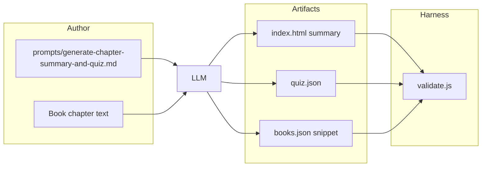

# Chapter authoring harness

Guardrails, validations, and workflow for adding Beyond the Chapter content **without** a build step.

## Quick start

```bash
# From repo root — must pass before you open a PR
node harness/validate.js
```

Preview locally (required for quizzes — `fetch` needs HTTP):

```bash
python3 -m http.server 8080
# http://localhost:8080/index.html
# http://localhost:8080/architecture/chapter-N/quiz.html
```

## Workflow (human + LLM)



1. **Generate** — Use [`prompts/generate-chapter-summary-and-quiz.md`](../prompts/generate-chapter-summary-and-quiz.md) with the chapter source text.
2. **Assemble** — Follow [`CONTRIBUTING.md`](../CONTRIBUTING.md): copy `quiz.html`, wire `index.html`, merge catalog entry.
3. **Validate** — `node harness/validate.js` (fix all errors; review warnings).
4. **Preview** — Click through home → summary → quiz (standard + perfect score → bonus interstitial).
5. **PR** — Push branch; CI runs the same harness.

## Guardrails (enforced)

| Rule | Why |
|------|-----|
| `books.json` chapter `id` / `number` unique | Home + nav stay consistent |
| `spotlight_chapter` exists in catalog | Home badge never lies |
| Every catalog chapter has `index.html`, `quiz.html`, `quiz.json` | No broken links |
| `data-chapter-id` matches folder name | `chapter-nav.js` resolves prev/next |
| Quiz: **12** standard + **4** bonus questions | Matches `quiz-engine.js` UX |
| Each question: **4** options, `answer` in `0..3` | Engine indexes options safely |
| Bonus `q` starts with `[BÔNUS IA 1]` … `[BÔNUS IA 4]` | Unlock copy and review UI |
| Standard questions must **not** use bonus prefix | Separates rounds clearly |
| `quiz.html` loads shared `quiz-engine.js` + CSS | No duplicated 800-line pages |

## Guardrails (warnings only)

- Bonus question should mention IA / LLM / copilot context (chapter ↔ AI bridge).
- `interstitial_html` should use `<strong>` around the bonus mode title.
- Duplicate quiz option text.
- Orphan `architecture/chapter-*` folder not listed in catalog.
- Chapters in `books.json` not sorted by `number`.

## LLM output checklist (before harness)

- [ ] Summary uses `<div class="card">` sections; pt-PT tone.
- [ ] No fabricated facts beyond the source chapter.
- [ ] `interstitial_html` references **this chapter’s** concepts + bonus mode name.
- [ ] Bonus items apply **chapter ideas** to **modern AI engineering** (trade-offs, not hype).
- [ ] JSON only — no trailing commas, no comments.

## CI

Pull requests run [`.github/workflows/validate-site.yml`](../.github/workflows/validate-site.yml) (`node harness/validate.js`).

## Extending the harness

Edit constants at the top of [`validate.js`](validate.js) (`GUARDRAILS`) if club rules change (e.g. bonus count). Keep in sync with [`assets/js/quiz-engine.js`](../assets/js/quiz-engine.js).